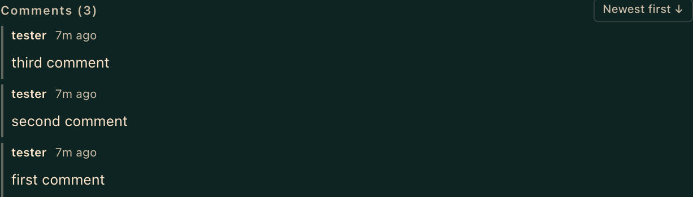
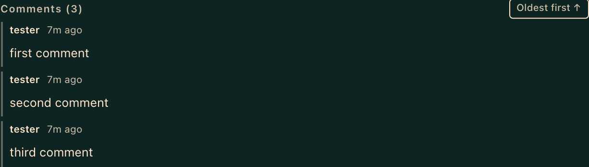

# hermes-kanban-comment-order

[](LICENSE)

Newest-first comments for the [Hermes Agent](https://github.com/NousResearch/hermes-agent) kanban board.

By default the task drawer lists comments oldest-first, so on a busy task the latest update is buried below the fold. This plugin flips the list so the most recent comment is on top, and puts a toggle in the Comments header to switch back.





## Features

- Newest-first by default.
- One-click **Newest first ↓ / Oldest first ↑** toggle in the Comments header.
- The choice is remembered per browser (`localStorage` key `hermes.kanban.commentOrder`), so it survives reloads.
- Pure CSS reordering: no React-managed DOM is moved, so the board's live updates and new comments don't fight the plugin.
- Leaves the "Child Results" section alone, even though the board renders it with the same row styles.
- Works regardless of the dashboard language (matches structure, not labels).

## Install

User dashboard plugins must be present in `~/.hermes/plugins/` **and** listed in `plugins.enabled`.

```bash
git clone https://github.com/zachristmas/hermes-kanban-comment-order.git ~/.hermes/plugins/kanban-comment-order
hermes plugins enable kanban-comment-order
curl http://127.0.0.1:9119/api/dashboard/plugins/rescan   # or restart `hermes dashboard`
```

Then hard-refresh the dashboard. (`hermes plugins enable` prints a "restart the gateway" notice. That applies to the agent side only; this plugin has none.)

Uninstall with `hermes plugins disable kanban-comment-order` and delete the directory.

## How it works

The built-in kanban drawer exposes no plugin slots, so the plugin watches the page with a `MutationObserver`, finds the Comments section by structure, tags it with a `data-` attribute, and `style.css` reverses that section's flex column while keeping the header on top. The toggle button is re-attached whenever the board re-renders the header.

## Compatibility and limitations

- Tested against Hermes `v0.21.7` (canary build). It depends on the board's `.hermes-kanban-*` class names, which are not a public API: **a Hermes update that renames them will break the plugin silently.** Rerun the tests after upgrading.
- The order setting is per browser, not per user or per board.
- Reordering is visual only. Screen-reader and tab order still follow the DOM (oldest-first).

## Development

The E2E test runs against a **sandbox** dashboard (a throwaway `HERMES_HOME` with this plugin enabled), never a live board.

1. Create a sandbox home, symlink this repo into `$HERMES_HOME/plugins/kanban-comment-order`, run `hermes plugins enable kanban-comment-order`, and start `hermes dashboard --port 9229`.
2. Seed a task with three comments, "first comment", "second comment", "third comment" (in that order, via `hermes kanban comment`).
3. Run:

```bash
cd e2e && npm install
KANBAN_E2E_URL=http://127.0.0.1:9229 KANBAN_E2E_TASK=<seeded task id> npx playwright test
# optional: CHROMIUM_PATH=<existing chrome-headless-shell> to skip the browser download
```

## License

[MIT](LICENSE) © 2026 Zach Christmas
